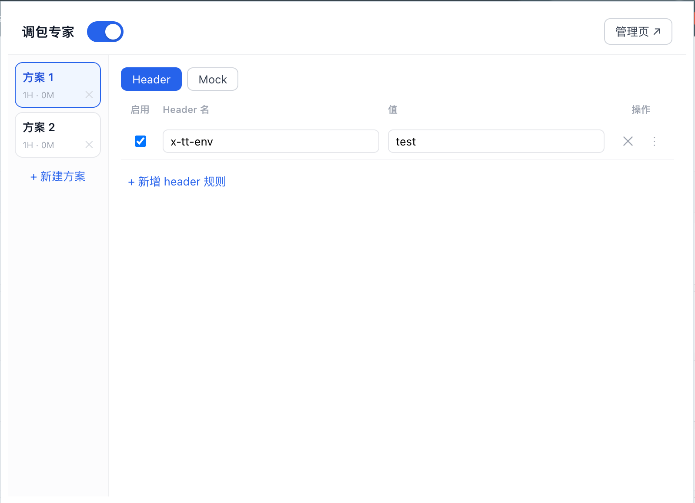
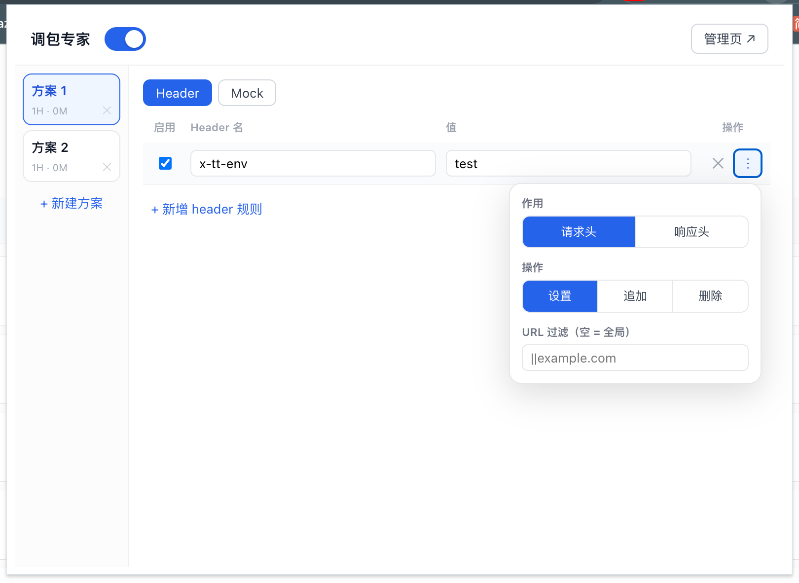
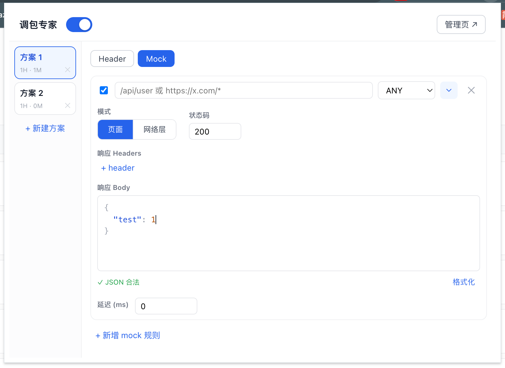
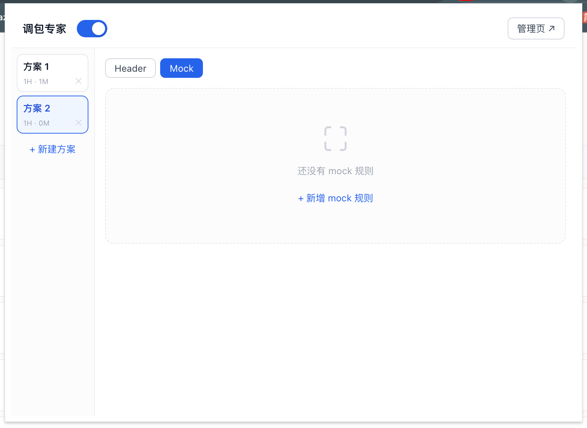

# 调包专家 (packet-swapper)

Chrome MV3 扩展。ModHeader 的干净开源替代——**无任何数据收集**，并额外支持 **mock 请求返回**。

> 详细用法见 [用户手册](docs/USER_GUIDE.md)。

## 功能

- **改请求头 / 响应头**：对请求增 / 改 / 删 header（基于 `declarativeNetRequest`，网络层稳定生效）
- **按 URL 条件生效**：每条规则可选 URL 过滤，空则全局
- **多套方案**：保存多组配置，单击切换当前生效的方案（数据层支持叠加）
- **Mock 请求返回**
  - **页面模式（主力）**：注入 hook 劫持页面 `fetch` / `XMLHttpRequest`，完全自定义 status / headers / body / delay
  - **网络层模式（补充）**：DNR redirect 到 `data:` URL，适合非 JS 发起的资源

## 界面预览

| 改 Header | `⋮` 菜单（作用/操作/URL 过滤） |
|:---:|:---:|
|  |  |

| Mock + JSON 编辑器 | Mock 空状态 |
|:---:|:---:|
|  |  |

## 安装（开发者模式）

```bash
npm install
npm run build      # 产出 dist/
```

1. Chrome 打开 `chrome://extensions`
2. 右上角打开「开发者模式」
3. 点「加载已解压的扩展程序」，选择本项目的 `dist/` 目录
4. 工具栏出现「调包专家」图标即安装成功

改完代码重新 `npm run build`，回到扩展页点刷新即可。开发时可用 `npm run dev`（watch 构建）。

## 用法

popup 和管理页（options）共用同一套编辑界面：

- **左侧方案栏**：**单选**——单击某方案即把它设为唯一生效的（其余自动停用），双击方案名重命名，`+ 新建方案`。
- **顶部总开关**：一键启停全部。
- **`Header` 标签**：每行 = 启用勾选 / Header 名 / 值 / 操作列；操作列的竖排三点 `⋮` 菜单里设「作用（请求头/响应头）、操作（设置/追加/删除）、URL 过滤」。
- **`Mock` 标签**：每条规则一张卡片，展开可编辑模式（页面/网络层）、状态码、响应 headers、响应 body（带 JSON 高亮 + 合法性检测 + 格式化）、延迟。
- 管理页顶部额外有**导入 / 导出**全部配置为 JSON。

配置写入 `chrome.storage.local`，background 监听变化实时重建 DNR 规则；页面 mock 由 content script 下发缓存。

## 生效优先级

- **多条规则冲突时「后定义赢」**（与 CSS 直觉一致）：
  - Header：同名同作用域的 `set`/`remove` 冲突，后定义的覆盖先定义的（靠 DNR priority 递增实现）；`append` 是全部叠加，不算冲突。
  - Network mock：同 URL 命中多条，后定义赢。
  - Page mock：同请求命中多条，取最后一条命中的规则。
- **page 与 network mock 同时命中**：对 `fetch`/`XHR`，page 模式在页面层直接拦截返回、根本不发真实请求，因此 **page 优先于 network**；非 JS 发起的资源（图片/文档等）只有 network 模式生效。
- **多方案**：数据层支持多个方案同时启用（规则叠加），但 UI 采用单选，正常情况下同一时刻只有一个方案生效。

## 无痕（Incognito）模式

Chrome 默认在无痕窗口禁用所有扩展。需手动开启：`chrome://extensions` → 「调包专家」→「详细信息」→ 打开「**在无痕模式下启用**」。

开启后即可在无痕窗口生效（改 header、page mock 均可用）。本扩展未设 `incognito` 键，采用默认的 `spanning` 模式：普通窗口与无痕窗口**共用同一个 background 和同一份配置**，因此规则原样生效、无需重配；反之也**无法给无痕单独配一套规则**。

## 开发

```bash
npm test          # vitest 单元测试（核心纯逻辑 + fetch/XHR hook 集成测试）
npm run typecheck # tsc --noEmit
npm run build     # 构建到 dist/
npm run icons     # 重新生成图标 PNG
```

构建分三步（见 `package.json`）：popup/options/background 走 Vite 多入口；两个 content script 各自用 lib 模式打成自包含 IIFE 追加进 `dist/`。

## 目录结构

```
src/
├── core/        # 纯逻辑：类型、规则编译器、匹配器、序列化、storage 封装、React hook
├── background/  # service worker：编译规则 → updateDynamicRules
├── content/     # content-iso（ISOLATED，下发规则）+ content-main（MAIN，hook fetch/XHR）
├── popup/       # React：总开关 + profile 切换
└── options/     # React：完整配置编辑
tests/           # vitest
```

## 已知限制（MV3 平台约束，非 bug）

- **响应头 / CORS**：部分响应头（尤其 CORS 预检相关）DNR 改不到，或需精确 host 权限。
- **网络层 mock 的状态码**：`data:` URL 响应恒为 `200`，网络层模式无法自定义状态码；需要自定义状态码请用**页面模式**。
- **网络层 mock 的 body 大小**：受 `data:` URL 长度上限约束，body 过大时管理页会对该规则标黄，建议改用页面模式。
- **页面模式 mock 注入时机**：content-main 在 `document_start` 注入并劫持 `fetch`/`XHR`；极早（注入前）发出的请求可能漏掉。
- **XHR mock**：伪造 `readyState` / 事件序列（`readystatechange` → `load` → `loadend`），未覆盖 `abort`/`timeout`/上传进度等边角场景。

## 不做（一期）

ModHeader 配置格式导入兼容、e2e 自动化、云同步 / 配置分享、请求日志面板、Firefox 兼容。详见 `docs/`。
