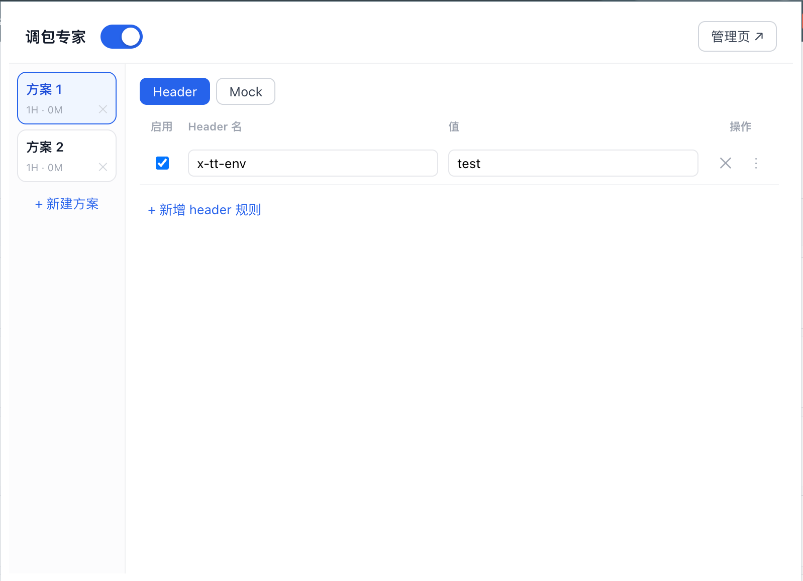
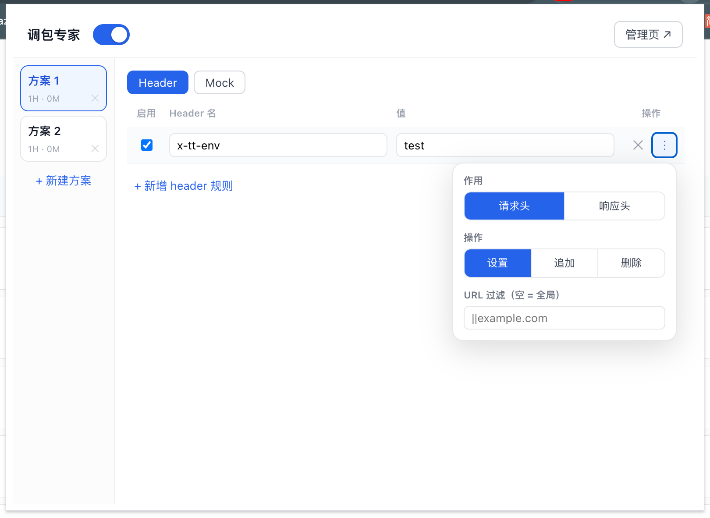
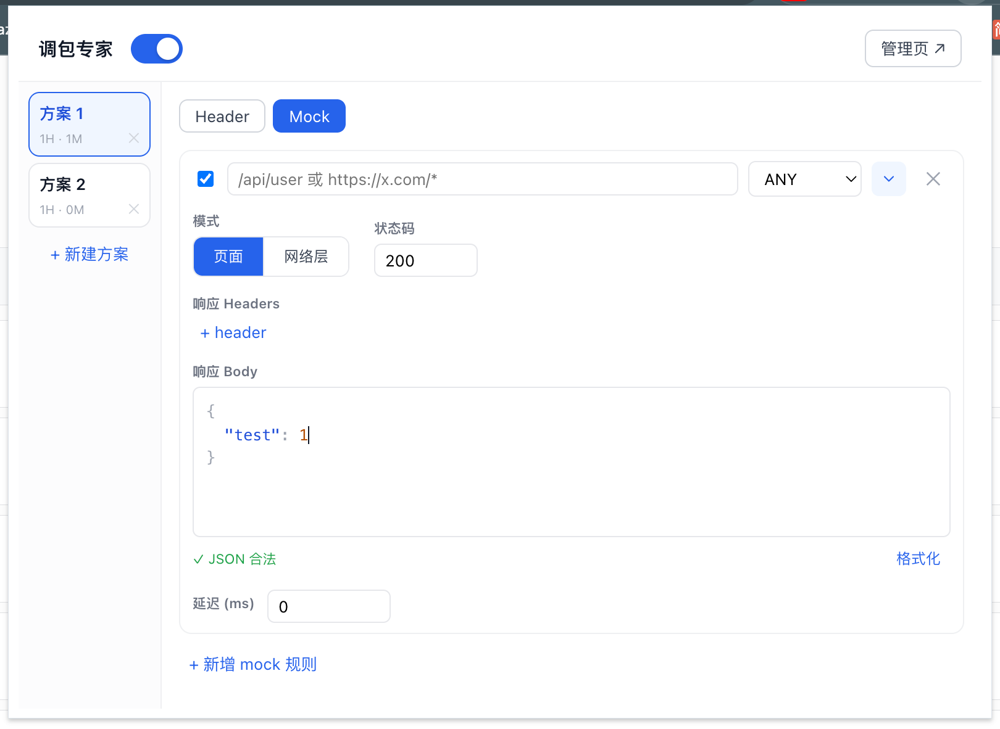

# 调包专家 · 用户手册

调包专家（Packet Swapper）是一个 Chrome 扩展，帮你在本地改 HTTP 请求头/响应头、按 URL 条件生效、多方案一键切换，并支持 mock 接口返回。ModHeader 的干净开源替代，**不收集任何数据**。

---

## 1. 安装

### 从源码构建（开发者模式）

```bash
npm install
npm run build          # 产出 dist/
```

1. Chrome 打开 `chrome://extensions`
2. 右上角打开「开发者模式」
3. 点「加载已解压的扩展程序」，选择本项目的 `dist/` 目录
4. 工具栏出现「调包专家」图标即安装成功

> 从商店安装的用户直接点「添加至 Chrome」即可。

---

## 2. 界面总览

点工具栏图标弹出 **popup**，点右上角「管理页 ↗」打开更宽的 **options** 页——两者是同一套编辑界面。

- **顶部**：总开关（一键启停全部）、`Header` / `Mock` 标签切换。
- **左侧方案栏**：你的所有方案。
- **右侧**：当前选中方案的规则编辑区。



---

## 3. 方案（Profile）

方案是一组规则的集合，用来区分不同场景（如「联调环境」「Mock 登录」）。

- **单击方案** = 把它设为**唯一生效**的方案（其余自动停用）。同一时刻只有一个方案生效。
- **双击方案名** = 重命名。
- **右下角 ✕** = 删除方案。
- **`+ 新建方案`** = 新建并立即切换到它。

---

## 4. 改 Header

在 `Header` 标签下，每行一条规则：

| 列 | 说明 |
|----|------|
| 启用 | 勾选才生效 |
| Header 名 | 如 `X-My-Header`、`Authorization` |
| 值 | header 的值；操作为「删除」时此列禁用 |
| 操作 | `✕` 删除该行；`⋮` 打开更多设置 |

点 **`⋮`** 展开更多设置：

- **作用**：请求头 / 响应头
- **操作**：设置（覆盖或新增）/ 追加（在已有值后追加）/ 删除（移除该 header）
- **URL 过滤**：留空 = 全局生效；填 DNR 语法可限定站点，如 `||example.com`（详见第 7 节）

> 当某行改过默认设置（响应头 / 追加 / 删除 / 填了 URL 过滤），`⋮` 会显示**琥珀色**提醒；菜单打开时显示**蓝色**。



**示例**：给所有请求加一个 `X-Debug: 1` 请求头 → 新增一行，名 `X-Debug`、值 `1`，`⋮` 里作用=请求头、操作=设置，URL 过滤留空。

---

## 5. Mock 接口返回

在 `Mock` 标签下，每条规则是一张卡片。概要行：启用勾选 / URL 匹配 / Method / 展开箭头 / 删除。

点箭头展开可编辑：

- **模式**：
  - **页面**（主力）：拦截页面 `fetch` / `XMLHttpRequest`，可完全自定义状态码、响应头、body、延迟。
  - **网络层**（补充）：把请求重定向到 data URL，适合非 JS 发起的资源。⚠️ 状态码恒为 200、body 不能太大（超限会标黄）。
- **状态码**：如 200 / 404 / 500（仅页面模式可控）。
- **响应 Headers**：如 `Content-Type: application/json`。
- **响应 Body**：内置 JSON 编辑器，支持语法高亮、合法性检测、`格式化` 一键美化。也可填纯文本。
- **延迟 (ms)**：模拟慢接口（仅页面模式生效）。



**URL 匹配**支持子串和 `*` 通配：
- `/api/user` → 任何 URL 含此子串即命中
- `https://x.com/api/*/detail` → `*` 匹配任意片段

**示例**：让 `/api/user` 返回假 JSON → 新建 mock，URL 匹配填 `/api/user`，Method=ANY，模式=页面，Body 填 `{"name":"mock"}`，响应 Headers 加 `Content-Type: application/json`。

---

## 6. 导入 / 导出

管理页右上角：

- **导出 JSON**：把全部方案存成 `packet-swapper-config.json`，用于备份或分享。
- **导入 JSON**：从文件恢复配置（会覆盖当前配置）。

---

## 7. 生效优先级（多条冲突时）

- **后定义赢**（与 CSS 直觉一致）：
  - Header：同名同作用域的「设置/删除」冲突，**后定义的覆盖先定义的**；「追加」是全部叠加，不算冲突。
  - Mock：同一请求命中多条，取**最后一条**。
- **页面 mock 优先于网络层 mock**：对 `fetch`/`XHR`，页面模式直接拦截返回、不发真实请求。非 JS 发起的资源才走网络层。

---

## 8. 无痕（Incognito）模式

Chrome 默认在无痕窗口禁用所有扩展。开启方法：

`chrome://extensions` → 「调包专家」→「详细信息」→ 打开「**在无痕模式下启用**」。

开启后规则在无痕窗口同样生效。普通窗口与无痕窗口**共用同一份配置**（无法为无痕单独配置）。

---

## 9. 常见问题 / 排查

- **改了 header 没生效？** 确认①总开关开着 ②该方案被选中（生效）③该行勾选了启用 ④URL 过滤没写错（先留空测全局）。在 DevTools → Network 里点开对应请求核对 header。
- **响应头改不到？** MV3 平台限制：部分响应头（尤其 CORS 预检相关）DNR 改不到，或需精确 host 权限。这是平台约束，非扩展 bug。
- **网络层 mock 状态码不对？** 网络层模式响应恒为 200；需要自定义状态码请用**页面模式**。
- **Body 那行标黄了？** 网络层 mock 的 body 过大（接近 data URL 长度上限），改用页面模式。
- **页面很早发的请求没被 mock？** content 脚本在 `document_start` 注入，极早发出的请求可能漏掉。
- **配置会丢吗？** 配置存在浏览器本地（`chrome.storage.local`），持久保存；卸载扩展才会清除。

---

## 10. 隐私

本扩展不收集、不上传任何数据，所有配置仅存于你本地浏览器。详见仓库根目录 `PRIVACY.md`。
